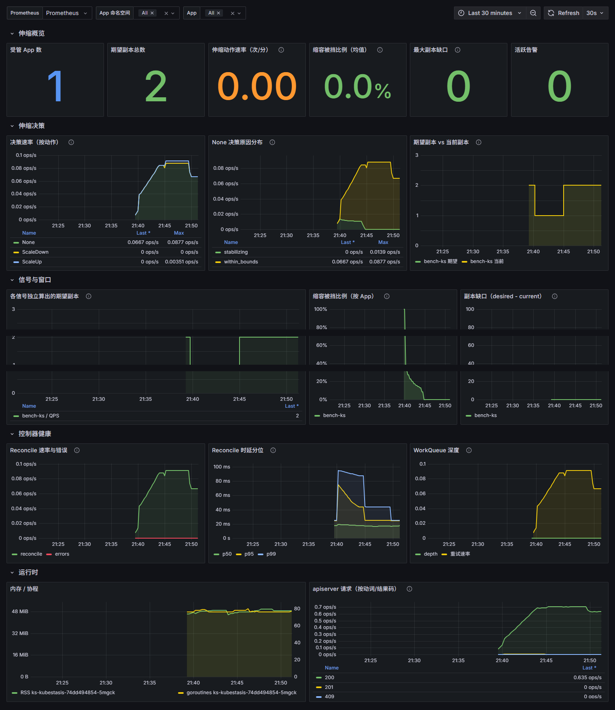

# KubeStasis

基于 controller-runtime 的 Kubernetes Operator：用一个 `App` CR 管住应用的**伸缩、自愈、准入**三件事。

**定位**：不是"HPA 替代品"，而是把"看指标伸缩 + 看故障自愈 + 准入期兜住错误配置"放进同一个控制回路，并对每条能力给出**可复现的实测证据**——而不是一张愿望清单。

[](https://github.com/weirong-ui/kubestasis/actions/workflows/ci.yml)
[](docs/STATUS.md)
[](https://go.dev)
[](LICENSE)

## 先看证据

| 能力 | 证据（点开即实录，含命令与原始输出） |
|---|---|
| 按 QPS 伸缩 | [500 QPS 打流 → 1→5 副本；停流后渐进缩回 1](docs/demo/01-scaling.md)（集群内真 Prometheus 按 Pod 抓取） |
| 分级自愈 | [crash 版本发布 → L2 摘除 → L3 按 ReplicaSet 回滚](docs/demo/02-self-healing.md)（CI 里有同链路回归断言） |
| vs 原生 HPA | [同镜像、同资源、同流量时间线的压测对比](docs/benchmark/hpa-vs-kubestasis.md)（扩容响应 23s vs 40s；输的两项也写在里面；原始 CSV 可复算） |
| 可观测性 | [Grafana 面板实测截图](deploy/monitoring/README.md)——4 行 16 个面板，含一次真实的 2→1→2（稳定窗口挡缩容、到点缩、再扩）；同目录还有录制规则与"伸缩引擎休眠"告警 |
| 全部能力/限制/踩坑 | [docs/STATUS.md](docs/STATUS.md)（唯一可信账本，含"已知不解决的问题"） |

CI 六道门：`docs`（链接有效性）/ `build`（gofmt + vet + 137 用例）/ `envtest`（真实 apiserver 的控制循环回归，4 条链路）/ `chart`（helm lint + 双形态渲染 + CRD 逐字节 diff）/ `e2e`（kind 真集群跑通伸缩、自愈、Webhook 负向用例）/ `image`（多架构 + cosign 签名）。

## 它长什么样

```yaml
apiVersion: kubestasis.io/v1alpha1
kind: App
metadata:
  name: order-service
spec:
  image: registry.example.com/order-service:v1.2.0   # 禁止 latest（Webhook 拦）
  replicas: 3
  port: 8080
  resources:                        # 透传到托管 Deployment
    requests: {cpu: 250m, memory: 128Mi}
    limits:   {cpu: 500m, memory: 256Mi}
  env:
    - name: LOG_LEVEL
      value: info
  scaling:                          # 省略则不做伸缩决策
    minReplicas: 2
    maxReplicas: 20
    cooldownSeconds: 120            # 冷却窗口：窗口内拒绝缩容，扩容不受限
    metrics:
      - {type: QPS, target: "1000"}        # 每 Pod 目标
      - {type: P99Latency, target: "200ms"}
  health:                           # 省略则不做自愈
    strategy: graduated             # graduated = L1 扩容 → L2 摘除 → L3 回滚
    canary:
      enabled: true
      observationSeconds: 300
      errorRateThreshold: "0.01"
```

`apply` 之后由控制器接管：创建/对齐 Deployment 与 Service、写回 `status`（真实就绪副本数、`Available`/`Progressing` Conditions）、发 Events 审计。

## 实测 vs 原生 HPA

同一镜像（每请求 8ms CPU 忙等）、同一资源（250m/500m）、同一副本区间（1–5），同样的突发流量时间线；唯一变量是伸缩器。
HPA 用 CPU 50%（全默认行为），KubeStasis 用 QPS 16/Pod（默认迟滞 10% + 冷却 120s + 渐进缩容 20%）。

<!-- BENCH_TABLE -->
| 指标 | 原生 HPA | KubeStasis |
|---|---|---|
| 突发#1 扩容响应 | 40s | **23s** |
| 空闲#1 结束时副本数 | 5 | **4** |
| 全程副本-分钟 | 72.8 | **63.7**（-12.5%） |
| 空闲后回到 1 副本 | **385s** | 450s（渐进缩容的代价） |

这张表只挑了能说明问题的四行，完整的（含输掉的那几项：突发#2 起点的一次误缩容、失败请求 99 vs 33、五轮废数据的归档）在报告里。

口径、原始 CSV、复现脚本：[docs/benchmark/hpa-vs-kubestasis.md](docs/benchmark/hpa-vs-kubestasis.md)

## 观测面板

决策过程不是黑盒：每次评估（包括"评估了但没动"）都打点，配合录制规则与 Grafana 面板可以直接回答

> 刚才为什么没缩？是稳定窗口在挡，还是信号本来就没掉？



上图的 2→1→2 是真实一次：停流后信号掉下来，稳定窗口连挡 5 轮（`stabilizing` 决策），窗口走满才缩到 1；重新打流后按冷却窗口扩回 2。
面板、录制规则、导入方式见 [deploy/monitoring/](deploy/monitoring/README.md)。

## 快速开始

需要 Kubernetes 1.28+，kind / minikube / Docker Desktop 均可。

```bash
make docker-build IMG=kubestasis:dev
make deploy-webhook IMG=kubestasis:dev       # 含 Admission Webhook（自签证书，不依赖 cert-manager）
kubectl apply -f config/samples/app_v1alpha1_app.yaml
kubectl get app sample -w                    # PHASE 到 Stable、READY 追上 DESIRED 即成功
kubectl get events --field-selector reason=KubeStasisScaleUp
```

不带 Webhook 用 `make deploy`；Windows 无 `make` 时用等价命令：`kubectl kustomize config/webhook-enabled | sed 's|IMG_PLACEHOLDER|kubestasis:dev|g' | kubectl apply -f -`。
伸缩需要 `--prometheus-url` 指向可用的 Prometheus（不配则伸缩休眠，其余功能不受影响）。

### 用 Helm 装（生产形态）

```bash
helm upgrade --install kubestasis charts/kubestasis -n kubestasis-system --create-namespace \
  --set image.repository=ghcr.io/weirong-ui/kubestasis --set image.tag=latest \
  --set prometheus.url=http://prometheus.monitoring:9090 \
  --set webhook.enabled=true
```

webhook 证书默认用渲染期自签（零外部依赖），也可切 cert-manager；完整 values 说明与 kustomize→Helm 迁移注意见 [charts/kubestasis/README.md](charts/kubestasis/README.md)。
伸缩决策自带 Prometheus 指标（`kubestasis_scaling_decisions_total` 等，查询示例见 `deploy/monitoring/recording-rules.yaml`），manager 的 metrics Service 开在 8080。

## 设计权衡

这一节记录**为什么这样做、放弃了什么**——代码能看出"做了什么"，看不出"为什么不是另一种做法"。

**为什么用迟滞带 + 冷却窗口，而不是单一阈值？**
单一阈值在阈值附近必然抖动：副本数一变，每 Pod 负载就落到阈值另一侧，于是来回扩缩。迟滞带（默认 10%）给"不动"留出死区，冷却窗口（默认 120s）拦住刚扩完就缩的反射式操作，缩容还限制单次步长（20%）。代价是收敛慢于理想值——这是用一点响应速度换稳定性的**主动选择**，不是实现不出来。

**为什么所有 spec 写回都走 Merge Patch + `RetryOnConflict`？**
`Update` 带整对象乐观锁，而 Deployment controller 会持续改 `status`，两边一撞就是 `the object has been modified`。改成"读-算-只 patch 变化字段-冲突重试"，把冲突从事务性问题降级为重试问题。没有换成 `Status().Update()` 单独走子资源，是因为我们要改的是 `spec`（副本数、镜像），不是状态。

**为什么 `Scaling`/`Health` 是指针？**
`omitempty` 对结构体不生效：值类型会把省略的字段序列化成零值对象，`minReplicas: 0` 直接被 CRD enum 拒掉。这不是理论问题，是真集群上第一轮 Reconcile 就炸出来的。指针让"未设置"和"设为零值"在序列化层面可区分。

**为什么自愈要分三级，而不是直接回滚？**
回滚是最贵、也最容易掩盖问题的动作。L1 扩容吸收瞬时压力、L2 摘除坏 Pod（可能是节点/网络的一过性问题）、只有冷却期内同故障复发才升级到 L3 回滚。分级让"能自愈的不发布"成为默认路径。

**放弃了什么（明确不做）**
- **eBPF 无侵入采集**：需要内核态开发与节点特权，收益是省掉应用埋点；对一个演示型项目，成本远大于收益。降为远景。
- **多集群调度**：跨集群联邦是独立课题（调度、网络、状态同步），塞进来只会让主链路不扎实。降为远景。
- **接 HPA 的 custom metrics API**：可以让 HPA 复用我们的指标，但那是在给别人做插件，无法承载"自愈"这个差异点。
- **cert-manager 依赖**：为了"一条命令能起"，改用 `hack/webhook-certs.sh` 自签 + 注入 caBundle；生产环境建议换 cert-manager。

## 项目结构

```
api/v1alpha1/        App CRD 类型 + DeepCopy（group: kubestasis.io）
cmd/                 manager（controller + webhook 同进程）/ demoapp（演示与压测负载）
internal/controller  Reconcile：Deployment/Service/Status/Conditions/Events
internal/scaler      伸缩决策（多信号取 max，决策与执行分离）
internal/healer      分级自愈 + 金丝雀回滚
internal/webhook     Validating + Mutating
pkg/miniinformer     手写 ListWatch/DeltaFIFO/Store/WorkQueue（学习模块，[原理](pkg/miniinformer/README.md)）
deploy/              demoapp 镜像、demo 与 benchmark 清单
policies/            Kyverno 集群级镜像信任策略（可选）
config/              CRD / RBAC / manager / webhook / kustomize overlay / samples
hack/                webhook-certs.sh、benchmark.sh
docs/                STATUS 账本、demo 实录、压测报告、系列文章素材
```

## 开发

```bash
make run                 # 本地跑（连当前 kubeconfig）
make manifests generate  # 重新生成 CRD/RBAC/DeepCopy
go test ./... -cover     # 单元测试（113 用例）
```

## Roadmap

> 勾选标准：代码已合并**且**能在干净集群复现。只有文档或骨架的阶段不勾。

- [x] P0 脚手架：CRD + Reconcile 管理 Deployment/Service + Status/Conditions + Events
- [x] P1 指标伸缩：Prometheus 多信号 + 冷却/迟滞（[实录](docs/demo/01-scaling.md)）
- [x] P2 分级自愈 + 金丝雀回滚（[实录](docs/demo/02-self-healing.md)，CI 回归）
- [x] P3 Admission Webhook + cosign 签名 + Kyverno 策略
- [x] P4 手写 mini-Informer（[设计笔记](pkg/miniinformer/README.md)）
- [x] 压测对比 vs 原生 HPA（[报告](docs/benchmark/hpa-vs-kubestasis.md)）
- [x] Helm Chart（`helm upgrade --install` 真集群验证，含自签/cert-manager 双证书方案）
- [x] 伸缩决策指标（`kubestasis_scaling_*` 四个指标 + recording rules）
- [ ] **未完成**：envtest（现在只有 fake client 单测 + kind e2e）、Grafana 面板入库
- 远景、不承诺排期：eBPF 采集、多集群

详细的逐条状态、已知坑、不解决的问题：[docs/STATUS.md](docs/STATUS.md)。

## License

Apache 2.0
