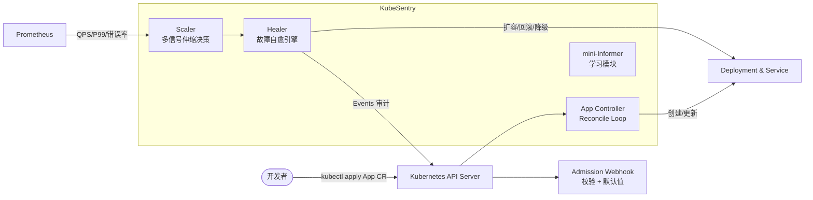

# KubeSentry — 云原生应用自愈与智能弹性伸缩 Operator

<p align="center">
  
</p>

[](https://go.dev)
[](https://kubernetes.io)
[](.github/workflows/ci.yml)
[](LICENSE)

> 一个基于 controller-runtime 的 Kubernetes Operator：不只让应用"活着"，还能让它**自己变强、自己疗伤**。
> 项目配套的系列文章发布在掘金：[《手写一个 K8s Operator：KubeSentry 设计与实现》](https://juejin.cn)

## 为什么做这个项目？

Kubernetes 原生的 HPA 只解决"伸缩"，不解决"自愈"：

| 能力 | HPA | KEDA | KubeSentry |
|---|---|---|---|
| 基于指标扩缩容 | ✅（CPU/内存） | ✅（多指标源） | ✅（QPS/P99 延迟/错误率） |
| 自定义伸缩策略（冷却窗口、震荡抑制） | ⚠️ 有限 | ⚠️ | ✅ 内置迟滞算法 |
| 故障自愈（CrashLoop / OOM / 5xx 飙升） | ❌ | ❌ | ✅ 自动降级/回滚/扩容 |
| 变更自动回滚（新版本发布后错误率上升） | ❌ | ❌ | ✅ 金丝雀观察窗口 |
| Admission 校验与默认值注入 | — | — | ✅ Validating + Defaulting Webhook |

## 核心特性

- **声明式应用模型**：通过 `App` CRD 描述应用 + 伸缩策略 + 健康策略，一个 YAML 管到底
- **智能弹性伸缩**：基于 Prometheus 指标（QPS / P99 / 错误率）的多信号伸缩决策，带冷却窗口与迟滞抑制，避免副本数震荡
- **故障自愈引擎**：识别 CrashLoopBackOff、OOMKilled、5xx 错误率飙升等故障模式，执行「扩容 → 降级 → 回滚」分级自愈动作，全程 Kubernetes Events 审计留痕
- **安全发布**：新版本发布先金丝雀小流量观察，错误率超阈值自动回滚
- **Admission Webhook**：CR 合法性校验 + 生产安全默认值注入（资源限制、安全上下文，呼应 CKS 知识点）
- **手写 mini-Informer**：`pkg/miniinformer` 是一个不依赖 informer 库、从零实现的 ListWatch + DeltaFIFO + 工作队列，用于吃透 client-go Informer 机制（面试高频考点）

## 架构



## 快速开始

```bash
# 1. 安装 CRD
kubectl apply -f config/crd/bases

# 2. 部署 Operator（含 RBAC 与 Webhook）
make deploy IMG=<your-registry>/kubesentry:latest

# 3. 创建一个受管应用
kubectl apply -f config/samples/app_v1alpha1_app.yaml

# 4. 观察 KubeSentry 的决策过程
kubectl get app myapp -w
kubectl get events --field-selector reason=KubeSentryScaleUp
```

一个最小的 `App` CR：

```yaml
apiVersion: apps.sentry.io/v1alpha1
kind: App
metadata:
  name: order-service
spec:
  image: registry.example.com/order-service:v1.2.0
  replicas: 3
  scaling:
    minReplicas: 2
    maxReplicas: 20
    cooldownSeconds: 120          # 冷却窗口，防震荡
    metrics:
      - type: QPS
        target: 1000              # 每 Pod 目标 QPS
      - type: P99Latency
        target: 200ms
  health:
    strategy: graduated           # graduated: 扩容→降级→回滚 分级自愈
    canary:
      enabled: true
      observationSeconds: 300     # 金丝雀观察窗口
      errorRateThreshold: 0.01    # 错误率超 1% 自动回滚
```

## 项目结构

```
kubesentry/
├── api/v1alpha1/          # App CRD 类型定义
├── cmd/                   # 入口：manager / webhook
├── internal/
│   ├── controller/        # 核心调和循环
│   ├── scaler/            # 伸缩决策引擎（迟滞 + 冷却）
│   ├── healer/            # 自愈引擎（故障识别 → 分级动作）
│   └── webhook/           # Admission Webhook
├── pkg/miniinformer/      # 手写 Informer（ListWatch / DeltaFIFO / WorkQueue）
├── config/                # kustomize / CRD / RBAC / Webhook 配置
├── charts/kubesentry/     # Helm Chart
└── docs/                  # 设计文档与系列文章
```

## 开发

```bash
# 本地运行（连当前 kubeconfig 集群）
make run

# 单元测试（envtest 起 etcd + apiserver）
make test

# 生成 CRD / DeepCopy 代码
make manifests generate

# 构建镜像（多阶段 + distroless）
make docker-build IMG=kubesentry:dev
```

## Roadmap

- [x] **P0**：App CRD + 基础 Reconcile + Deployment 管理
- [x] **P1**：Prometheus 多信号伸缩 + 冷却/迟滞算法
- [x] **P2**：故障自愈引擎 + 金丝雀自动回滚
- [x] **P3**：Admission Webhook（校验 + 安全默认值注入）
- [x] **P4**：手写 mini-Informer + 原理系列文章
- [ ] **P5**：基于 eBPF 的无侵入指标采集
- [ ] **P6**：多集群容灾调度

详见 [docs/ROADMAP.md](docs/ROADMAP.md)。

## License

Apache 2.0
