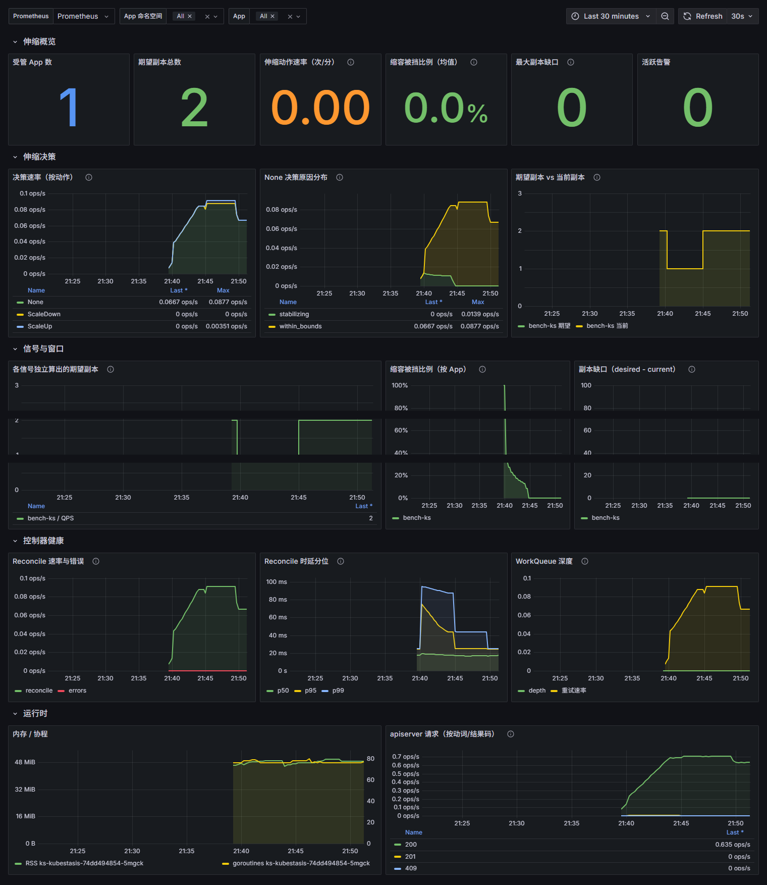

# KubeStasis 监控：指标 → 录制规则 → Grafana 面板

三层各管一件事：

| 层 | 文件 | 管什么 |
|---|---|---|
| 指标 | `internal/metrics/`（控制器 `:8080/metrics`） | 每次伸缩决策打点：`kubestasis_scaling_decisions_total{namespace,app,action,reason}` + desired/current/signal 三个 gauge |
| 录制规则 + 告警 | `recording-rules.yaml` | 预聚合：`kubestasis:scaling_decisions:rate5m`、`kubestasis:scale_down_blocked:ratio5m`、`kubestasis:scaling_replica_gap`；告警 `KubeStasisScalingDormant`（伸缩引擎休眠） |
| 面板 | `grafana/kubestasis-dashboard.json` | 把上面两层变成 4 行 16 个面板：概览 / 伸缩决策 / 信号与窗口 / 控制器健康 |

## 前提

1. Prometheus 在抓控制器的指标端点。Helm 安装时开 ServiceMonitor：

   ```bash
   helm upgrade --install ks charts/kubestasis -n kubestasis-system \
     --set metrics.serviceMonitor.enabled=true
   ```

   裸 Prometheus（无 Operator）则加一段 scrape job（按 Pod 抓，不要按 Service——
   Service 会被随机路由到不同后端，counter 非单调）：

   ```yaml
   - job_name: kubestasis-controller
     # 决策指标的 namespace label 是 App 的命名空间（业务语义），不开 honor_labels
     # 会被目标标签（控制器 Pod 所在 ns）覆盖、原值改名 exported_namespace
     honor_labels: true
     kubernetes_sd_configs:
       - role: pod
         namespaces:
           names: [kubestasis-system]
     relabel_configs:
       - source_labels: [__meta_kubernetes_pod_container_port_name]
         regex: metrics
         action: keep
       # 下面两条必须显式映射：kubernetes SD 的 meta 标签不会自动落到时序上，
       # 面板"控制器健康/运行时"行靠 namespace 过滤（ServiceMonitor 默认会带，手写 job 不会）
       - source_labels: [__meta_kubernetes_namespace]
         target_label: namespace
       - source_labels: [__meta_kubernetes_pod_name]
         target_label: pod
   ```

2. 录制规则已加载：`kubectl apply -f deploy/monitoring/recording-rules.yaml`
   （Prometheus Operator 环境；否则把 `spec.groups` 抄进 `prometheus.yml` 的 `rule_files`）。
   面板里"缩容被挡比例""副本缺口"两个面板依赖它，缺了这两格是空的，其余面板不受影响。

## 导入面板（三选一）

**A. UI 导入**：Grafana → Dashboards → New → Import → 上传 `grafana/kubestasis-dashboard.json`，选 Prometheus 数据源。

**B. sidecar 自动发现**（kube-prometheus-stack 推荐）：

```bash
kubectl apply -k deploy/monitoring/grafana/ -n <grafana 所在命名空间>
```

ConfigMap 带 `grafana_dashboard: "1"` 标签，sidecar 会自动挂载。

**C. 静态 provision**：把 JSON 放进 Grafana 的 provisioning dashboards 目录。

## 面板怎么读

- **为什么一直没扩/没缩？** → "None 决策原因分布"：`no_metrics_source` 是没接指标源（告警 `KubeStasisScalingDormant` 同源）；`stabilizing`/`cooldown`/`hysteresis` 是窗口在按设计挡；`within_bounds` 是 min/max 顶住了。
- **稳定窗口是不是配太长？** → "缩容被挡比例"持续接近 100% 就该调 `scaling.scaleDownStabilizationSeconds` 或检查信号目标。
- **哪个信号在推动伸缩？** → "各信号独立算出的期望副本"，最终决策取最大值，最高的那条线就是主导信号。
- **控制器本身健不健康？** → "控制器健康"行：Reconcile 错误率、p99 时延、WorkQueue 深度。

## 实测截图（kind 集群 + 真实 Prometheus）



验证环境：kind 单节点、控制器由 Helm release `ks` 安装在 `kubestasis-hv`、
Prometheus 抓 `kubestasis-hv` 的控制器 metrics 端口 + `bench` 的 benchapp，
App `bench/bench-ks` 带 QPS 信号在跑。面板变量 `$ctrl_ns` 默认 `kubestasis.*`，
你的控制器装在别的命名空间时改这一个变量即可（变量默认隐藏，Dashboard Settings → Variables 里改）。
